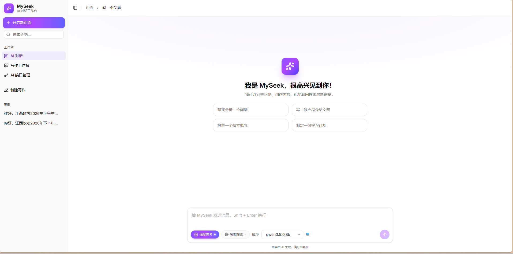

# MySeek Web

**MySeek 的 Web 前端** —— 一个面向企事业内部的 AI 对话工作台，支持多模型切换、流式输出、会话管理与知识库问答。与 [MySeek 后端](../my-seek/README.md) 配套使用。


---

## 界面预览

<p align="center">
  
</p>

<p align="center">
  <em>聊天页：多轮对话、Markdown 渲染、模型切换与会话列表</em>
</p>

---

## 功能特性

- **多模型切换**：本地 Ollama、豆包、千问，按请求动态选择
- **流式对话**：逐字输出， Markdown / 代码高亮 / 数学公式（KaTeX）渲染
- **会话管理**：侧边栏会话列表，历史消息持久化，按用户隔离
- **知识库问答**：上传文档后基于 RAG 进行检索增强回答
- **统一鉴权**：JWT 登录，未授权自动跳转登录页并携带回跳地址
- **响应式布局**：可折叠侧边栏，适配不同屏幕尺寸

## 技术栈

| 类别 | 技术 | 版本 |
| --- | --- | --- |
| UI 框架 | React | 19.3 |
| 路由 | React Router | 7.18（SPA 模式） |
| 语言 | TypeScript | 5.9（strict） |
| 构建 | Vite | 7.3 |
| 样式 | Tailwind CSS | 4.3 |
| 状态管理 | Redux Toolkit | 2.14 |
| 组件库 | shadcn/ui（Radix UI） | — |
| 包管理 | pnpm | 11 |

## 快速开始

### 环境要求

- Node.js 22+
- pnpm 11+
- 后端服务已启动并监听 `8080` 端口（见 [`my-seek`](../my-seek/README.md)）

### 安装与运行

```bash
pnpm install
pnpm dev
```

浏览器打开 `http://localhost:5173`。

开发环境下 Vite 会把所有 `/api` 请求代理到 `http://localhost:8080`，代理规则见 `vite.config.ts`。

### 校验与构建

```bash
pnpm typecheck   # react-router typegen + tsc
pnpm build       # 产出静态站点到 build/client
```

## 部署

本项目为 **SPA 模式**（`ssr: false`），`pnpm build` 的产物是 `build/client/` 下的纯静态文件。部署时需要：

1. 用任意静态服务器托管 `build/client/` 并确保未知路径回退到 `index.html`；
2. 配置反向代理，将 `/api` 转发到后端服务。

> 仓库中的 `Dockerfile` 为早期模板遗留（仍基于 npm / Node 20），尚未适配当前的 pnpm + Node 22 工具链，请勿直接用于生产。

## 目录结构

```
app/
├── components/   # 界面组件（聊天、登录、布局、通用 UI）
├── routes/       # 文件路由（home / login / dashboard）
├── pages/        # 页面级组件
├── store/        # Redux 切片（用户、会话、模型）
├── lib/          # HTTP 客户端、鉴权工具
├── auth/         # 登录状态 Context
└── services/     # 类型声明
assets/           # README 截图
```

## 相关项目

| 项目 | 说明 |
| --- | --- |
| `my-seek` | Spring Boot 4 + Spring AI 2 后端，提供鉴权、对话、向量库与知识库接口 |

## 开源协议

本项目采用 [MIT License](./LICENSE) 开源协议。
